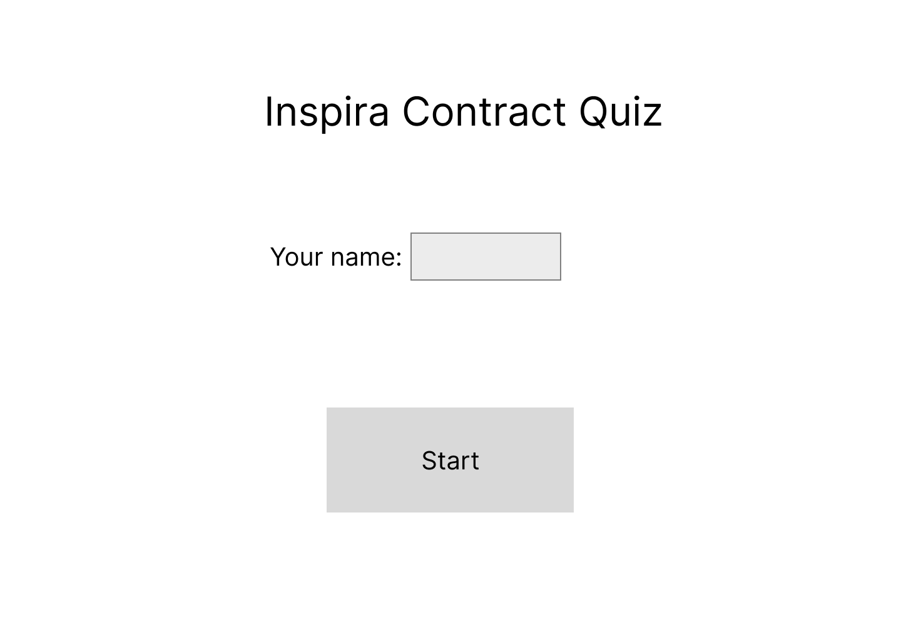
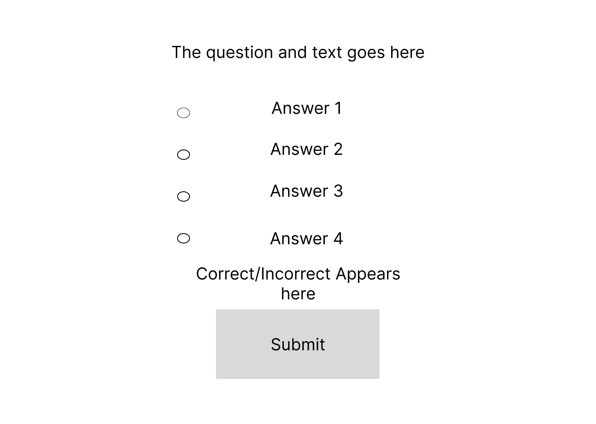
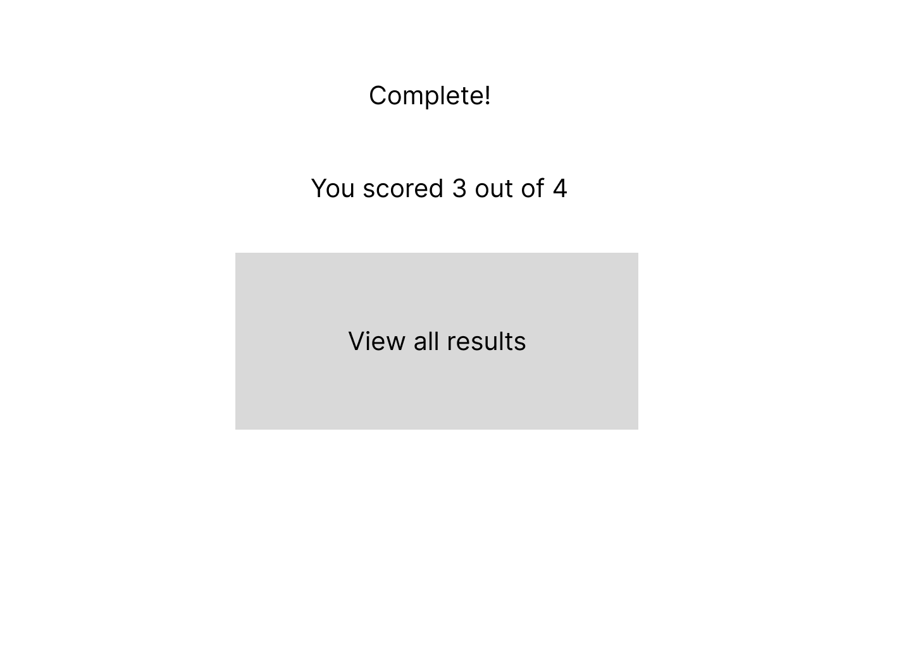
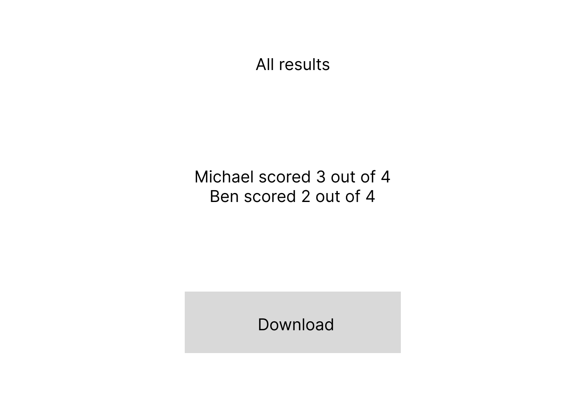
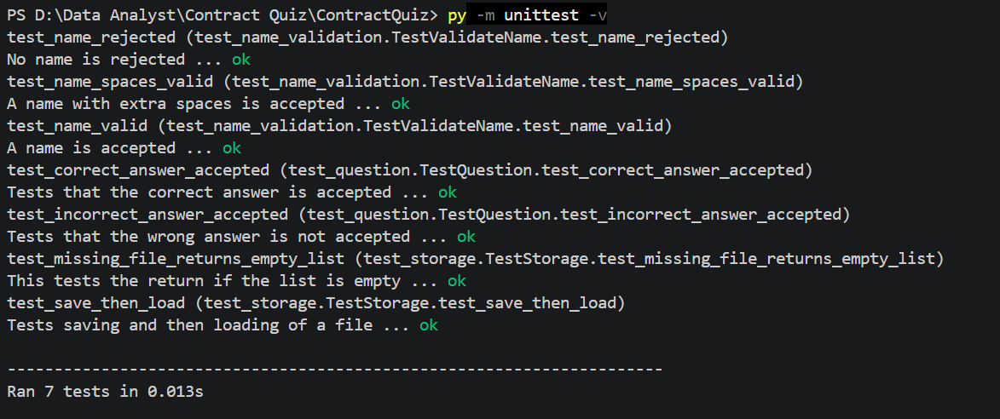

# Inspira Contract Quiz
## Introduction

Inspira, the company I work for, is a registered charity that aims to help various groups of people into employment. Despite being a relatively small company, with around one hundred employees, we work across a wide variety of contracts. Many employees will work within their own contractual bubble and may be unaware of the scope of our other contracts. Whilst wider knowledge of contracts may not be requirement for all roles at the company, it can still be beenficial. For example, staff that man the telephone lines may be confronted with queries not relevant to their contract and would therefore benefit from the knowledge to redirect those calls.

One of the most significant criteria with out contracts is the eligibility of certain age groups. As such, it is important that staff be aware as to whether a customer is eligible for a contract before they progress any further with a conversation to avoid either wasting customer and staff time or mismatching a customer and contract (which could have funding implications and reprecussions). As such, I have created a brief quiz which tests the users knowledge of certain contracts and their eligibility criteria. 

## Design

During the design process, I decided to keep the design simplistic and functional as the quiz itself was quite simple. I began with the home page:



This page has a title to identify to the user the name of the quiz, as well as a text box for them to enter their name. Below that, a button to begin the quiz. Next, a template for the questions page:



This page has space for the question at the top, as well as for answers with radio buttons for selecting the correct one. There is then an option to submit a question, above which text will indicate whether or not they are correct before allowing them to move onto the next question. Next is the end point:



At the end of the quiz, the user is given their score and option to see all results:



Here the user can see all other results and download them via the download button. The user journey is laid out in the below collected screenshot:


## Development
### Structure
There were four files as part of the project:

| main.py | name_validation.py | question.py | storage.py |

The purpose of this choice to break into four files was so that I could test logic separately from the main.py which involved screens.

### Name validation
```python
def validate_name(name):
    """Return True if name is valid"""
    trimmed_name = name.strip()
    if trimmed_name == "":
        return False
    return True
```
This was the code used to validate that a name was input into the text box. Firstly, strip() is used to trim the name down in the event that a user has accidentally included spaces. Then the final three lines simply check whether the name is blank. If the name is blank, it returns false. Otherwise, it returns true. This is a pure function as it will always return the same result for the same input. As show below, this is used in the main.py file under start_quiz:

```python
    def start_quiz(self):
        """Starts quiz"""
        name = self.name_entry.get()
        if not validate_name(name):
            self.error_label.config(text="Please enter your name.")
```

### Questions
```python
class Question:
    """One Question in the quiz"""

    def __init__(self, question_text, answers, correct_answer):
        """Stores question text, answers and the correct answer"""
        self.question_text = question_text
        self.answers = answers
        self.correct_answer = correct_answer

    def is_correct(self, answer_choice):
        """Return True if correct"""
        return answer_choice == self.correct_answer
```
The Question class acts as a template for the structure of the questions in the quiz. There is a question text, set of answers and correct answer. The use of a class helps keep the code organised as each question can be written as an object of that class. The __init__ runs when each question is created and stores the question text, answers and correct answer letter for that question. The letter doesn't need to be included in the answers as they are stored as a zip list. The is_correct line takes the letter choice and compares with the correct stored answer, returning true if they match

This is used in the main.py code, to create the list of questions: 
```python
QUESTIONS = [
    Question("What is the age range for the TCIAG Contract?", ["13-18", "19-25", "19-45", "All adults"], "A"),
    Question("Would an under 18 be eligible for Connect to Work?", ["Yes", "No", "Yes, if they match certain elgibilty criteria", "Yes, if they are able to pay"], "C"),
    Question("Are courses funded by ASF open to under 18s?", ["Yes", "No", "Yes, but they must pay tuition fees", "Yes, as long as they are not working or in education"], "B"),
    Question("Can 18 year olds be seen on the National Careers Service?", ["Yes", "No", "Yes, but they must not be in employment or education", "Yes, but they must attend appointments with a parent or guardian"], "C"),
]
```
It is also used to show the current question from the list:

```python
question = QUESTIONS[self.current]
```

### Storage

```python
import csv


def save_result(filename, name, score, total):
    """Stores individual test score results"""
    try:
        with open(filename, "a", newline="") as file:
            csv.writer(file).writerow([name, score, total])
        return True
    except OSError:
        return False


def load_results(filename):
    """Returns all saved results"""
    try:
        with open(filename, newline="") as file:
            return list(csv.reader(file))
    except FileNotFoundError:
        return []
```

This file serves the purpose of saving each result and also allows for them to be loaded. The results are saved into a CSV file, meaning the storage is persistent. The reason I chose a CSV file is because it is a simple quiz, with simple data and therefore doesn't need complex storage.. It also allows for managers to be able to open the data easily without installing software other than Excel.

This code works by writing the name given by the user, their score and the total score into a row. It saves each new result by appending to the previous rows, to avoid data being deleted. It uses try and except lines to catch errors and return safe values rather than crashing. This is significant on the load_results block, as it stops the system crashing if no results have yet been saved or if the file has been wiped. 

### GUI

I used Tkinter for the user interface as it was built-in and had the widgets I needed for this simple quiz. Using a similar approach to the project structure, I split methods into different screens and used clear_screen to swap between them.

```python
    def clear_screen(self):
        """Remove everything from the window."""
        for widget in self.window.winfo_children():
            widget.destroy()
```
The below code block shows the check_answer method:

```python
    def check_answer(self):
        """Selected answer is checked against correct answer"""
        question = QUESTIONS[self.current]
        choice = self.choice.get()
        if choice == "":
            self.feedback_label.config(text="Please choose an answer.", fg="red")
            return
        elif question.is_correct(choice):
            self.score = self.score + 1
            self.feedback_label.config(text="Correct!", fg="green")
        else:
            self.feedback_label.config(text="Incorrect", fg="red")
        self.submit_button.config(state="disabled")
        tk.Button(self.window, text="Next", command=self.next_question).pack(pady=10)
```

This method collects the current question and the user's choice. If the choice is blank, red text asks the user to select an answer. If the answer choice is correct, the user's score increases by 1 and green text indicates they were correct. If the answer choice is incorrect, red text indicates they were incorrect. The submit button is disabled and a next button appears. The reason for disabling the submit button was discovered during testing, it was found repeatedly pressing it continually increased the score.

## Testing

Unit testing was done for the name_validation, question and storage parts. This is because they were simple functions and testing this way was easily repeated. Manual testing was done for the screens, as they are more complicated and have a visual aspect that may need alterations.



 Test | Steps | Expected result | Actual result | Pass/Fail |
|---|---|---|---|---|
| Empty name | Nothing written in text box | Message that doesn't allow progress | Message appeared | Pass |
| Spaces-only name | Only spaces written in text box | Message that doesn't allow progress | Message appeared | Pass |
| Valid name | A valid name written in text box | Allowed progress to next screen | Next screen shown | Pass |
| Submit with no answer selected | All radio buttons unselected when clicking submit | Message asking for answer to be selected | Message appeared | Pass |
| Clicking submit multiple times | Clicking submit repeatedly rather than clicking next | No effect | Score continually increase | Fail |
| Clicking submit multiple times FIX | Clicking submit multiple times blocked by disabling button after use | No effect from multiple presses | No effect | Pass
| Correct answer | Select correct answer and click submit | Message saying correct, submit button disabled and next button shown | Message and buttons appeared as appropriate | Pass |
| Wrong answer | Select incorrect answer and click submit | Message saying incorrect, submit button disabled and next button shown | Message and buttons appeared as appropriate | Pass |
| Final score shown | Clicking next on final question  | Score shown out of total possible score | Score shown correctly | Pass |
| Result saved to CSV | Results automatically save to CSV | Results will be seen inside CSV file | Results did save to file | Pass |
| View all results | Click all results button | Correct shown with all results in a list and button to export results | Correct screen and button shown | Pass |
| Export results | Click export results button | Opens a save window and gives message to say export successful | Save window opens and text appears | Pass |

## Documentation
### User

1. To open the app, run main.py which would open the quiz window. 
2. Enter your name into the text box. If you do not, the quiz will not progress. 
3. There are four questions, each one requires you to select one answer and click submit. After that, select next and move onto the next question
4. When you have answered all four questions you will reach the end point screen, which will show you your score. 
5. You may view all other saved scores by clicking the all results button.
6. On the all results screen, you may export the results as a CSV by clicking the export button.

### Technical

Required software: Python 3.14 (Windows)

Files:
| Name | Purpose |
|---|---|
| main.py | Main file containing quiz |
| name_validation.py | File containing name validation function |
| question.py | File containing Question class and is_correct function |
| storage.py | File containing save_result and load_results functions |
| results.csv | Automatically created file. Is created after first completion quiz. Contains all saved results |

Should you wish to change the questions in the quiz, find the QUESTIONS line (8) in main.py. Below is the list of questions which can be added to or altered. 

## Self-Evaluation

I have created a simple quiz that fits within the criteria requested. I chose to keep the design as simple as I could in order to focus my attention on the technical aspects. In hindsight, I feel as though the design and the final product would have benefitted from more thought towards user experience. Whilst functional, the screens are not visually appealling and, in particular, the screen that lists all results may become cluttered and unusable. I have also not kept entirely in keeping with the intital design, in terms of button size. This was an issue with the intial design which I did on a much larger screen. When testing the screens I realised smaller buttons would be more appropriate for a wider range of screen sizes. 

The choice to separate my logic into separate files worked out well as I could test them separately without having to open the screens. This then made implementing them into the screens better. I do think I could have taken this further though. For example, the list of questions is stored within main.py but on reflection a separate file containing a list of questions would have been better. For example, a CSV would have allowed users to change the questions without needing to open VS Code. 

I also could have added more rules to the name validation. Currently it accepts any string. I could have restricted the type of characters that it would have accepted, to add an extra layer of input validation.

The biggest problem I had during development was discovered when testing the submit button. Realising that it would continue to add to the score when pressed even after the question had been answered. I was pleased with the solution I discovered to disable the button between screens.  